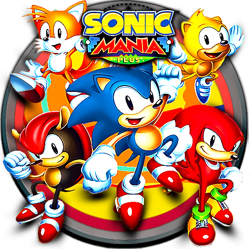

# Sonic Mania Plus — RG DS Plus

Unofficial standalone Sonic Mania port for **Anbernic RG DS Plus, Stock Linux OS**.
One **SonicMania_PLUS** launcher, native ARM64 execution, and no RetroArch core or PortMaster required.

**Bring your own legally obtained `Data.rsdk` and appropriate game/DLC licence. Game data is not included.**

## Download and install

1. Open this repository's **Releases** section and download `SonicManiaPlus_RGDSPlus_v1.0.zip` from **Assets**.
2. Extract it and copy the included `APPS` folder into your TF2 card's `Roms` folder, merging it with the existing `Roms/APPS` folder. Use the APPS directory already used by your Stock menu.
3. Copy your `Data.rsdk` to `Roms/APPS/SonicMania_RGDSPlus/Data.rsdk`.
4. Safely eject the card and launch **SonicMania_PLUS** in the console's APPS menu.

The icon is installed as `APPS/Imgs/SonicMania_PLUS.png`, next to the launcher directory.
There is only one main launcher: `APPS/SonicMania_PLUS.sh`.
Keep the complete `SonicMania_RGDSPlus` support folder.

### Updating

Merge the new APPS folder and replace the supplied files. Your game data, saves,
options and existing controller mapping are not shipped or overwritten.
An old `SonicMania.sh` launcher is archived under `tools/atalhos-anteriores` on first launch.
The obsolete `APPS/Imgs/SonicMania.png` icon can be removed manually.

## Features

- Native Linux aarch64 port for the RK3568/Cortex-A55.
- D-pad and left analogue stick configured for the tested Stock controller; no initial calibration needed.
- Upper display output; lower backlight switches off during play and restores its previous brightness on exit.
- Physical volume keys, levels 0–10, with the gain curve `0.35 × (level / 10)²`.
- System volume is captured before launching and restored after exit, including error/signal cleanup and an independent process watcher.
- 44.1 kHz stereo audio with a 2048-frame requested buffer.
- Deadline-based 60 Hz pacing with VSync disabled in the launcher.
- Frame/audio diagnostics for reporting problems.

## Controls

| Control | Action |
| --- | --- |
| D-pad / left stick | Move and navigate |
| A / B | Jump and actions; A confirms menus |
| START | Start / pause |
| SELECT + START, hold about one second | Save options and exit normally |
| Physical volume + / − | Adjust in-game listening level |

The console returns to its pre-game system volume when you exit.

## Tested performance and scope

In the supplied RG DS Plus test, Special Stage 1 (the UFO chase) reported **59.93–60.07 FPS**
across seven non-loading ten-second windows. Normal stages tested also ran near 60 FPS.
Occasional longer frames and scene-loading pauses remain; this is not a guarantee for every scene.
Recorded audio timing/clipping indicators were zero in that session.
The maintainer subsequently confirmed the final setup was working.
See [validation notes](docs/VALIDATION.md) for measurement limits.

Target: **RG DS Plus running Stock Linux**, SDL2/Wayland/ALSA. Other hardware or firmware is unverified.

## Plus and Extras

The executable is compiled with DLC **disabled by default**, following the upstream engine licence.
Choosing `SonicMania_PLUS.sh` explicitly requests Plus using the platform's opt-in environment setting.
Use it only with the appropriate game/DLC licence. This project does not supply DLC assets.
Locked Extras follow normal in-game progress; they are not an installation error.

## Troubleshooting

- **Missing Data.rsdk:** use the exact destination above; filenames are case-sensitive.
- **No icon:** confirm `APPS/Imgs/SonicMania_PLUS.png` matches `SonicMania_PLUS.sh`.
- **Missing files after updating:** this is a full release; recopy APPS and retain your game data.
- **Report a problem:** exit normally and attach `SonicMania_Arranque.txt` and `log.txt` from the support folder before launching again. Never attach Data.rsdk or your saves.

Optional calibration, compatibility and VSync comparison scripts are in `SonicMania_RGDSPlus/tools`.
They all use the single Plus launcher. Normal use does not require them.

## Source and build

The complete modified engine/game source and recursive dependencies are in
[Sources/sonicmania-rgds-source.tar.xz](Sources/sonicmania-rgds-source.tar.xz).
It is compressed to keep browser upload manageable; extract it to inspect or build the complete tree.
The launcher/hardware recovery scripts are directly readable under `APPS`.
See [BUILD.md](BUILD.md), the upstream revision manifest and included tests in `Sources`.
This repository is a release snapshot, not a fork preserving upstream commit history.

## Credits and licences

- Original game and characters: **SEGA** and their respective authors.
- Original RSDK engine: **Evening Star** and its respective authors.
- Sonic Mania decompilation: [RSDKModding and contributors](https://github.com/RSDKModding/Sonic-Mania-Decompilation).
- RSDKv5 decompilation: **Rubberduckycooly, chuliRMG and contributors**.
- RG DS Plus port, testing and packaging: **Filipe Baeta**.
- **Icon: [hatemtiger — Sonic Mania Plus icon (.ico)](https://www.deviantart.com/hatemtiger/art/Sonic-Mania-Plus-icon-ico-945862352)**. Included PNG is copied without modification.

See [CREDITS.md](CREDITS.md) and [LICENSE.md](LICENSE.md). This is an unofficial,
noncommercial adaptation; it is not affiliated with or endorsed by SEGA or Anbernic.
No original game datapack or user progress is distributed.
